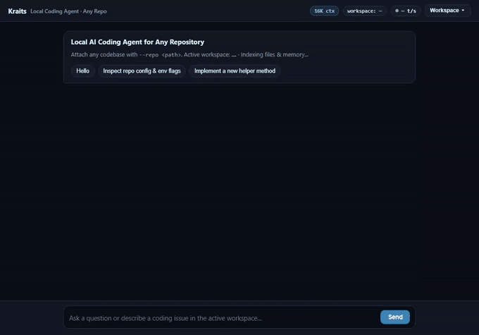

# Kraits

A drop-in plugin for `llama.cpp` that runs large mixture-of-experts models (such as **`Qwen3.8-Flash-Next-IQ4_XS`**, `90.97 GiB` across 3 shards) **100% offline** on a **base `16 GB` Apple Silicon Mac** at **`16K` context (`-c 16384`)**, together with **`kraits-adaptor`** — a zero-dependency AST indexer, KV-prefix lock proxy, and loop-guarded coding-agent harness & web UI.

Zero cloud calls, zero telemetry — built for private and NDA client repositories.



## Quick Start (macOS arm64 — `v0.6.29`)

1. Download and unpack **`kraits-v0.6.29-macos-arm64.tar.gz`** from [Releases (`v0.6.29`)](https://github.com/1picassoai/kraits/releases/tag/v0.6.29) (bundles `llama-server b11936`, patched `libggml-metal`, `libggml-kraits.dylib`, `libkraits.dylib`, `kraits-server.sh`, and `kraits-adaptor`):

```sh
curl -LO https://github.com/1picassoai/kraits/releases/download/v0.6.29/kraits-v0.6.29-macos-arm64.tar.gz
tar -xzf kraits-v0.6.29-macos-arm64.tar.gz
cd kraits-v0.6.29-macos-arm64
```

2. Download **`Qwen3.8-Flash-Next-IQ4_XS`** (`90.97 GiB`, 3 shards) from [`bartowski/Qwen3.8-Flash-Next-GGUF`](https://huggingface.co/bartowski/Qwen3.8-Flash-Next-GGUF):

```sh
hf download bartowski/Qwen3.8-Flash-Next-GGUF \
  --include "Qwen3.8-Flash-Next-IQ4_XS/*" \
  --local-dir ./models
```

3. Start the server (`16K` context on `:8099`) and attach `kraits-adaptor` to any local Git repo (`http://127.0.0.1:8100`):

```sh
# Terminal 1: Start llama-server with Kraits
./kraits-server.sh ./models/Qwen3.8-Flash-Next-IQ4_XS/Qwen3.8-Flash-Next-IQ4_XS-00001-of-00003.gguf 8099 16384

# Terminal 2: Point kraits-adaptor at any local Git repository
./kraits-adaptor serve --repo /path/to/your/repo --listen 127.0.0.1:8100 --upstream http://127.0.0.1:8099
```

Or build `kraits-adaptor` from source (`cargo test --release && cargo build --release` inside [`kraits-adaptor/`](kraits-adaptor/README.md)).

## How `91 GB` Fits Inside `16 GB` Unified Memory

Kraits keeps full **4-bit (`IQ4_XS`)** weights intact on disk rather than re-quantizing below 3 bits:

- **Embeddings off Metal:** `token_embd` and the `51.2B` `per_layer_token_embd` n-gram table stay CPU `mmap`-backed (`-ot ...=CPU`).
- **Compact `q4_0` KV cache (`-c 16384`):** Leaves room for a **`7.20 GB`** wired Metal bank holding **`56–57` of `512` experts per layer** across all `48` layers.
- **Prefill bulk warm + async NVMe decode:** Prompt processing bulk-loads active experts into the bank; during token generation, Metal masks uncached picks without stalling while an async NVMe worker promotes missing top-1 experts.

## Measured Performance (`16 GB` Apple M4, `-c 16384`, `Qwen3.8-Flash-Next-IQ4_XS`)

- **Bare decode:** up to **`18.0 tok/s`** (`17.94–18.24 tok/s` across 256-token runs)
- **Inside multi-turn coding loops (`kraits-adaptor`):** **`15.6–17.9 tok/s`** (`13–14 tok/s` after `12K` prompt depth)
- **Prompt prefill:** **`30 tok/s`** on short cold prompts (`1.6K`), scaling to **`48–67 tok/s`** (`6–12K`)
- **Memory & swap (`vm.swapusage`):** **`7.20 GB`** wired bank, keeping macOS swap around **`230–370 MB`**
- **Quality & known limits:** Passes **`8/8`** on our Rust benchmark and **`4/4`** single-function Flask unit-test fixes on Windows (`2/4` on clean Mac build prior to `F25–F28`); accurate at **`6K`** pasted-code Q&A, while recall past `12K` and multi-file greenfield synthesis (`0/7`) remain limited.

**Documentation:** [`kraits-adaptor/README.md`](kraits-adaptor/README.md) · [`BUILD.md`](BUILD.md) · [Kraits Wiki](https://github.com/1picassoai/kraits/wiki)

## Credits

- [llama.cpp and ggml](https://github.com/ggml-org/llama.cpp), by Georgi Gerganov and contributors (MIT).
- [Candle](https://github.com/huggingface/candle), by Hugging Face and contributors (MIT or Apache 2.0).

## Licence

Apache 2.0. See `LICENSE` and `NOTICE`. The models keep their own licences.
