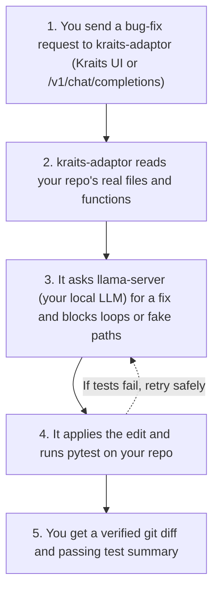

# Kraits


A plugin for `llama.cpp` that runs mixture-of-experts models bigger than a 16 GB Mac's GPU can hold, together with **`kraits-adaptor`** — a zero-dependency AST indexer, KV-prefix lock proxy, and loop-guarded coding-agent harness.

## How It Works



## How to Get Started

- **Documentation & Guides:** **[Kraits Wiki](https://github.com/1picassoai/kraits/wiki)** (setup, architecture, loop-control gates, and tested results)
- **Adaptor CLI & Endpoints:** [`kraits-adaptor/README.md`](kraits-adaptor/README.md) (`cargo test --release`, `cargo build --release`, `serve` flags, and `/kraits/*` API)
- **Latest Release:** **[Kraits v0.6.28 — Repo Adaptor](https://github.com/1picassoai/kraits/releases/tag/v0.6.28)** (signed tag `v0.6.28` — build on Mac with `cargo build --release`)
- **macOS `llama.cpp` Plugin (`bin/`):** See [`BUILD.md`](BUILD.md) (previous macOS release tarball: [v0.6.17](https://github.com/1picassoai/kraits/releases/tag/v0.6.17))

### Quick Start (`kraits-adaptor`)

1. Start `llama-server --jinja` on `http://127.0.0.1:8099`.
2. Build and launch `kraits-adaptor` against your local Git repository, then open `http://127.0.0.1:8100`:

```sh
cd kraits-adaptor
cargo build --release
./target/release/kraits-adaptor serve --repo /path/to/your/repo --listen 127.0.0.1:8100 --upstream http://127.0.0.1:8099
```

## Verified Benchmark (`v0.6.28`, `pallets/flask`)

Tested with `llama-server --jinja` and `Qwen3.8-Flash-Next-IQ4_XS` on a 16 GB Mac (`-c 10240`, `16.5–17.7 tok/s`, 83 indexed Python files):

- **Planted single-function Python bugs:** **`4/4`** green on signed `v0.6.28` (**`73–189 s`**, `4–9` turns, KV prefix `cache_n = 988`); **`23/26`** across `v0.6.21–v0.6.28`.
- **Known limits:** Multi-file features and real open GitHub issues (`#6123`) remain **`0/7`** at this model size and 10K context.

## Credits

- [llama.cpp and ggml](https://github.com/ggml-org/llama.cpp), by Georgi Gerganov and contributors (MIT).
- [Candle](https://github.com/huggingface/candle), by Hugging Face and contributors (MIT or Apache 2.0).

## Licence

Apache 2.0. See `LICENSE` and `NOTICE`. The models keep their own licences.
