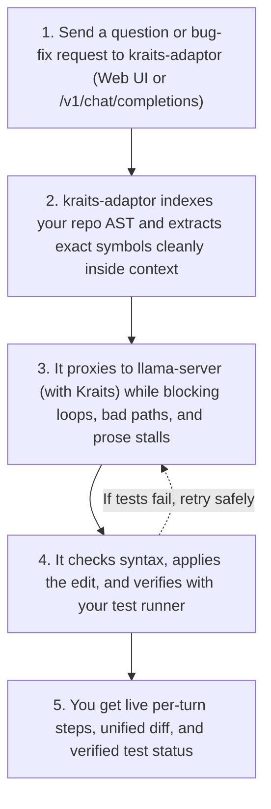

# Kraits Repo Adaptor (`kraits-adaptor`)

Zero-dependency AST indexer, KV-prefix lock proxy, loop-guarded coding-agent loop, and web UI (`/`). Works with any local Git repository via `--repo <dir>`.

## How It Works



## Build & Test

Requires Rust (`cargo`). Zero external crates (`Cargo.toml`). Auto-falls back between `python` and `python3` (`19/19` tests on macOS and Windows).

```sh
cd kraits-adaptor
cargo test --release
cargo build --release
```

Binary output: `target/release/kraits-adaptor`.

## Quick Start (`serve`)

1. Start `llama-server --jinja` (e.g. via [`../bin/kraits-server.sh`](../bin/kraits-server.sh)) on `http://127.0.0.1:8099`.
2. Point `kraits-adaptor` at any local Git repository and open `http://127.0.0.1:8100`:

```sh
kraits-adaptor serve --repo /path/to/your/repo [--listen 127.0.0.1:8100] [--upstream http://127.0.0.1:8099]
```

*(Note: When testing the built-in `pallets/flask` demo actions in `Workspace ▾`, install `flask` (`pip install -e ./flask pytest asgiref`) in an active Python environment; requires Python >= 3.11 for Flask `main` or checkout tag `3.1.2` for older Python.)*

| Flag | Default | Description |
| --- | --- | --- |
| `--repo <dir>` | `.` | Path to the single locked target Git repository |
| `--listen <host:port>` | `127.0.0.1:8100` | Local HTTP bind address for UI, `/kraits/*`, and `/v1/chat/completions` |
| `--upstream <url>` | `http://127.0.0.1:8099` | `llama-server` URL (auto-detects `n_ctx` via `/props`) |

### Other CLI Subcommands

```sh
kraits-adaptor index  --repo <dir>
kraits-adaptor purge  --repo <dir>
kraits-adaptor ast    --repo <dir> <rel-file>
kraits-adaptor symbol --repo <dir> <rel-file> <symbol>
kraits-adaptor query  --repo <dir> <query> [--budget <chars>]
kraits-adaptor learn  --repo <dir> --kind <kind> --sig <sig> --detail <detail> [--file <rel>]
```

## Tested Configuration (`v0.6.29`, `-c 16384`)

Tested with `llama-server --jinja` and `Qwen3.8-Flash-Next-IQ4_XS` (`16 GB` M4 Mac, `-c 16384`):

- **Decode:** up to `18.0 tok/s` bare; `15.6–17.9 tok/s` across coding turns (`13–14 tok/s` past `12K` depth).
- **Single-function planted bugs (`pallets/flask`):** `4/4` (`73–189 s`) on Windows signed `v0.6.28`; `2/4` on clean Mac `main` build prior to `F25`–`F28` fixes.
- **Known limits:** Multi-file feature synthesis and open GitHub issues (`#6123`) remain `0/7`.

## Endpoints & Web UI

| Method & Path | Purpose |
| --- | --- |
| `GET /` or `GET /ui` | Single-column coding chat UI with auto-grow input, live step traces, and diff drawer |
| `POST /v1/chat/completions` | OpenAI-compatible proxy with repo context injection & default non-thinking guard |
| `GET /kraits/repo` | Version, `upstream_n_ctx`, indexed AST files, and served request count |
| `GET /kraits/file?path=<rel>` | Line count and AST symbol skeleton for an indexed file |
| `GET /kraits/memory` | Persisted `.kraits/` episodic lessons and hot-file counts |
| `GET /kraits/diff` | Current `git diff` in the locked repository |
| `POST /kraits/learn` | Record a convention/pitfall lesson into `.kraits/memory.jsonl` |
| `POST /kraits/task` | Start an agent task (`{"prompt": "..."}`) -> returns `{"task_id": "..."}` |
| `GET /kraits/task?id=<task_id>` | Poll task status, turn traces, git diff, and final summary |
| `POST /kraits/demo` | Demo harness (`{"action": "bug1"\|"bug2"\|"feat1"\|"reset"\|"pytest", "target": "..."}`) |

*Note: The `bug1`, `bug2`, and `feat1` demo actions assume a `pallets/flask` checkout.*
